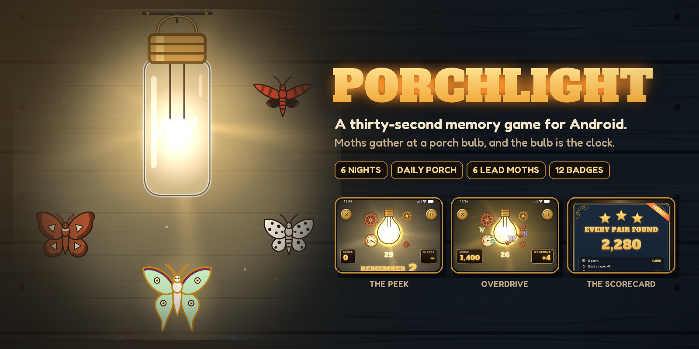
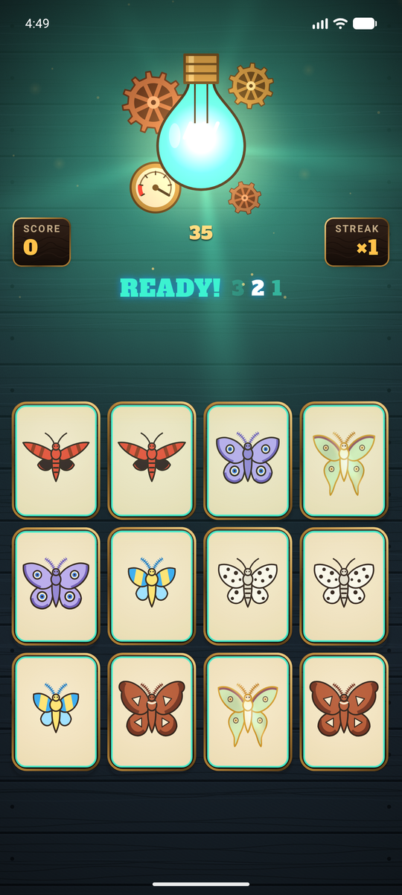
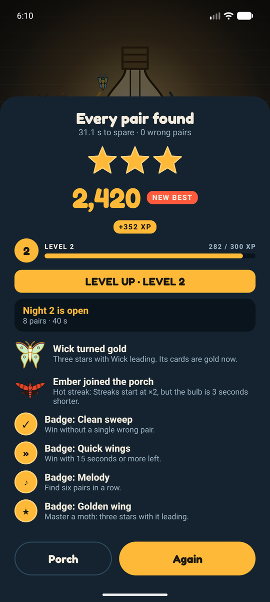
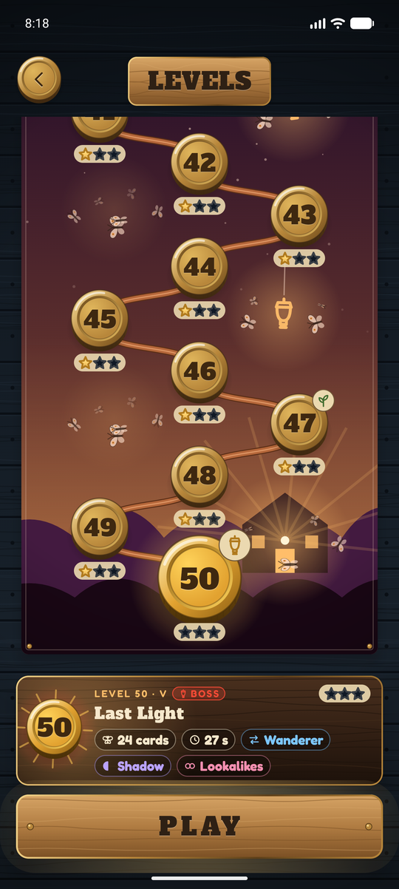
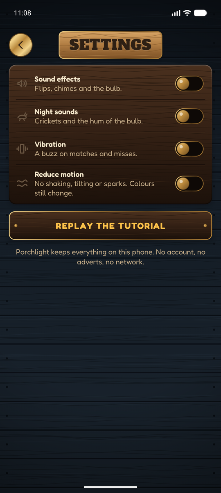
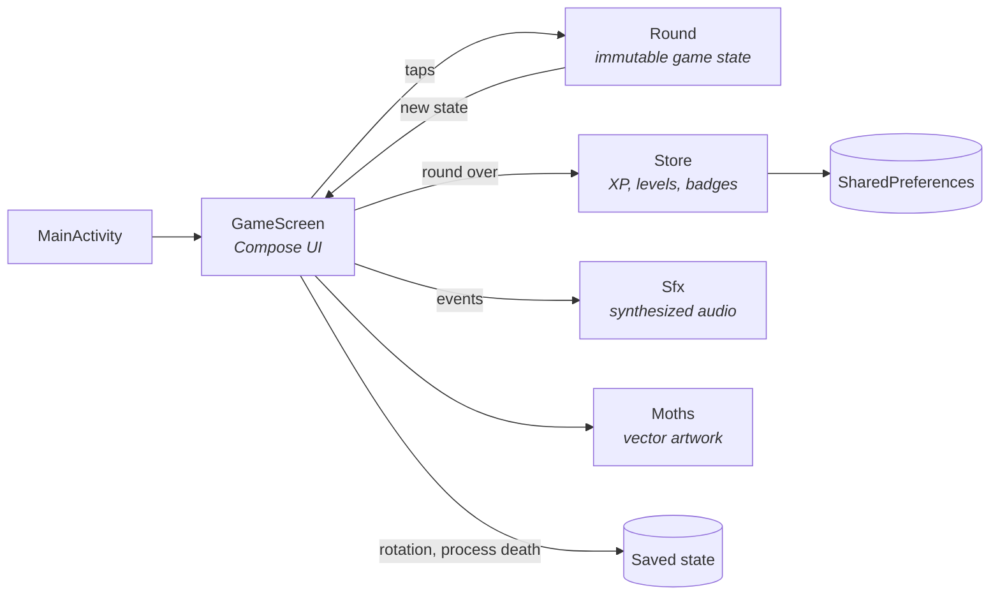

<div align="center">



# Porchlight

**A thirty-second memory game for Android.**<br>
Moths gather at a porch bulb, and the bulb is the clock. Find every pair before it burns out.

<a href="https://github.com/ImtiazHossain-Eshan/porchlight/actions/workflows/android.yml"></a>


<a href="LICENSE"></a>

[Game](#the-game) · [Screens](#screens) · [The moths](#the-moths) · [Levels](#levels-and-the-daily-porch) · [Progression](#progression) · [Architecture](#architecture) · [Get started](#get-started) · [Tests](#tests) · [Releases](#builds-and-releases)

<sub>Designed and built by Imtiaz Hossain</sub>

</div>

---

## The game

You get a two-second look at the cards. Then they fold shut, and the porch bulb starts to burn down.

1. **Peek.** Every card opens for two seconds. Remember where the moths landed.
2. **Match.** Turn two cards. A pair leaves the board: both moths fly up and circle the bulb.
3. **Chain.** Pairs in a row multiply: ×2, ×3, then ×4 *Overdrive*. One wrong pair breaks the chain.
4. **Beat the bulb.** Finish early and every second left is worth 20 more points.

There is no timer bar. **The bulb is the timer.** It burns warm white with time to spare, turns amber as it runs down, and goes deep orange near the end. In the last five seconds it turns red, flickers and buzzes. At zero it pops, the moths scatter, and the porch goes dark. A bold gold band around the bulb drains as the time runs out, and the seconds sit under it if you want the exact time.

Pick a lead moth before each round. Each one bends the rules its own way.

## Screens

<table>
  <tr>
    <td align="center" width="20%"></td>
    <td align="center" width="20%"></td>
    <td align="center" width="20%"></td>
    <td align="center" width="20%"></td>
    <td align="center" width="20%"></td>
  </tr>
  <tr>
    <td align="center"><sub><b>The lobby</b><br>Tap the jar for the light</sub></td>
    <td align="center"><sub><b>The peek</b><br>Remember, 2, 1</sub></td>
    <td align="center"><sub><b>Overdrive</b><br>The light turns gold</sub></td>
    <td align="center"><sub><b>Last seconds</b><br>Red, smoke, flicker</sub></td>
    <td align="center"><sub><b>Scorecard</b><br>Built line by line</sub></td>
  </tr>
  <tr>
    <td align="center"></td>
    <td align="center"></td>
    <td align="center"></td>
    <td align="center"></td>
    <td align="center"></td>
  </tr>
  <tr>
    <td align="center"><sub><b>Fifty levels</b><br>Five chapters, one map</sub></td>
    <td align="center"><sub><b>Daily porch</b><br>One scored try a day</sub></td>
    <td align="center"><sub><b>Lead moths</b><br>Wings beating in jars</sub></td>
    <td align="center"><sub><b>Badges</b><br>Seventeen medals</sub></td>
    <td align="center"><sub><b>Settings</b><br>Four switches</sub></td>
  </tr>
</table>

A 15-second gameplay clip is in [`docs/store/gameplay.mp4`](docs/store/gameplay.mp4).

## The moths

### Six leads

You start with Luna. Each level up brings the next lead to the porch.

| | Moth | Role | Perk | Unlocks |
| :---: | --- | --- | --- | :---: |
|  | **Luna** | The night owl | **Long-life bulb.** The round starts with 5 extra seconds. | Level 1 |
|  | **Wick** | The sprinter | **Hot streak.** Streaks start at ×2, but the bulb is 3 seconds shorter. | Level 2 |
|  | **Atlas** | The mapmaker | **Second look.** Once a round, flash every card open for a moment. | Level 3 |
|  | **Dot** | The counter | **Quick hands.** Wrong pairs flip back instantly, and your first miss doesn't break the streak. | Level 4 |
|  | **Iris** | The watcher | **Long look.** The opening peek lasts 3.4 seconds instead of 2. | Level 5 |
|  | **Sorbet** | The sweet tooth | **Top-up.** Every pair you find adds a second to the bulb. | Level 6 |

A unit test plays every lead with a perfect player and with one who misses 30% of the time, and checks that no lead beats the rest by more than 15% on both score and time.

### Six more on later levels

| | | | |
| :---: | :---: | :---: | :---: |
| <br>**Sulphur** | <br>**Rose** | <br>**Midnight** | <br>**Moss** |

Sulphur and Rose join on level 8, Midnight and Moss on level 16, and **Ash** and **Tide** on level 36, the first 12-pair board. Two lookalikes, **Domino** (Dot's near-twin) and **Lilac** (Iris's), only appear on Lookalikes levels.

Every moth has one main colour no other moth uses, and a wing shape or pattern of its own, so you can tell any two apart at a glance.

## Levels and the daily porch

Fifty levels in five chapters of ten, each on its own stretch of the map. Every chapter has a breather (marked with a sprig) on its 7th level and a boss (a bigger coin with a lamp) on its 10th.

| Chapter | Scene | Levels | Opens at | What's new |
| :---: | --- | :---: | :---: | --- |
| 1 · First Light | The porch | 1–10 | — | Boards grow from 3 to 8 pairs |
| 2 · Wanderers | The garden | 11–20 | 15 ★ | **Wanderer:** after a wrong pair, two face-down cards swap places |
| 3 · Dead Leaves | The woods | 21–30 | 35 ★ | **Dead leaves:** turning one costs 2 seconds |
| 4 · Shadows | The rooftops | 31–40 | 55 ★ | **Shadow:** one moth is a silhouette during the peek. **Lookalikes:** two moths are near-twins |
| 5 · Last Light | The last porch | 41–50 | 80 ★ | The twists in pairs, and all three of Wanderer, Shadow and Lookalikes on the last boss |

Beating a level opens the next; a new chapter also needs its total of stars. Rounds run from 7 seconds on level 1 to 36 on the longest boards, and the peek is set per level. Lose a level three times in a row and an **Easier bulb** retry is offered: 20% more time, for one star at most. Boss wins earn half again as much XP.

Each new twist is introduced once, in one line with a small animation, the first time you play it. The full table, with simulated win rates for casual, average and strong players, is in [`docs/LEVELS.md`](docs/LEVELS.md); `LevelCurveTest` checks the difficulty curve on every build. Saves from the six-night version carry over: each night's stars move to the matching level.

**Daily porch.** The deal comes from today's date, so everyone gets the same porch. You get one scored try a day. Play on consecutive days to build a streak, and share your result as a card.

The share window previews the card, switches between a feed post (1080 × 1350) and a story (1080 × 1920), and offers **Share image** or **Copy text**. The card shows the date, your lead moth under the lamp, your stars and score, and a flight log: one tile per turned pair, in order, with the moth you matched or an empty tile for a miss. The higher your streak, the brighter the tile's ring. The log never shows where the cards lay, so it doesn't spoil the deal for anyone else. A lost round gets a card too, with the lamp dark.

The text line goes along with the image (and is what **Copy text** copies):

```
Porchlight daily 20261114 ★★☆ 2,340
```

The image is drawn from the game's own wall, lamp and moths at full size, without shaders, so it looks the same on every phone. If it can't be made, the game shares the text line alone.

## Progression

<table>
<tr>
<td valign="top" width="50%">

**XP and levels**

| Source | XP |
| --- | ---: |
| Score | score ÷ 10 |
| Win (or finish) | 50 (10) |
| Each star | 20 |

Levels need 200, 500, 900, 1,400 and 2,000 XP in total.

**Stars**

| Star | For |
| :---: | --- |
| ★ | Finding every pair |
| ★ | A quarter of the bulb or more left |
| ★ | Few enough wrong pairs: 2 in chapters 1–2, 3 in chapters 3–4, 4 in chapter 5, one fewer on a boss |

The daily porch keeps its own rule: a third of the bulb left, and no wrong pairs.

**Mastery.** Win three stars with a lead on level 10 or later and that moth turns gold on every card.

**Pacing.** A round hands over at most two unlocks. A new level and a new lead always arrive at once; a gold moth and badges that don't fit wait and arrive in later rounds.

</td>
<td valign="top" width="50%">

**Badges**

| Badge | How to earn it |
| --- | --- |
| First light | Finish a round. |
| Clean sweep | Win without a single wrong pair. |
| Quick wings | Win a board of 8 pairs or more with 15 seconds left. |
| Overdrive | Reach a ×4 streak. |
| Melody | Find six pairs in a row on a board of 8 pairs or more. |
| Night shift | Play 10 rounds. |
| Full roster | Win once with every lead. |
| Wanderers | Win a level where the cards move. |
| Last light | Win a level with three twists at once. |
| Regular | Play the daily porch three days running. |
| Golden wing | Master a moth: three stars with it leading, on level 10 or later. |
| Gilded porch | Master all six leads. |
| The porch … The last porch | Five chapter stamps, one for beating each chapter's boss. |

</td>
</tr>
</table>

### Feel

- Every tap answers at once: the card dips under your finger, turns in 3D, lifts off the board, and the moth wakes up and flaps.
- A wrong pair flashes red, shakes, and both moths snap their wings shut.
- Streaks build. ×1 throws a few sparks. ×2 throws more. ×3 adds a bass note, a bulb flare and a warm glow at the screen edge. ×4 *Overdrive* freezes the frame for an instant, shakes the porch, sends a gold shockwave out from the pair and slides OVERDRIVE across.
- When a streak breaks, the counter cracks and drops back to a dash with a low thunk. (It shows a dash, not ×1, until there is a streak.)
- The score counts up instead of jumping.
- All particles come from one pool of 200 that is allocated once.
- **Reduce motion**, from the settings or the system's animation setting, turns off the shake, freeze and sparks but keeps the colour changes.

### Look

The porch is built by hand, and every surface is a made thing drawn in code: night-stained planks, walnut and oak panels with grain and bevels, brass and copper plates with rivets, gears and pipes, parchment, plum velvet and glass. No image files ship.

The bulb is the clock. Its glow shrinks and its colour runs from warm white with time to spare, to amber at 40%, deep orange under 15%, and red in the last five seconds, when it also flickers two to four times a second. The peek burns at full warm brightness.

A round opens like the porch light warming up. The cards drop onto the board face down one by one while the bulb is dark, then it flickers twice and comes on (tap to skip this). The cards turn up in a wave from the bulb down, the band says REMEMBER, and one big number counts the whole seconds left to look: 2, 1 for a 2-second peek, and 4, 3, 2, 1 for Iris's 3.4 seconds. The cards' warm rims brighten in the last half second. Then the cards fold shut from the bottom row up, GO! punches in, the bulb flares and the round's clock starts. Pausing during the peek holds the countdown exactly where it was. A recording is in [`docs/visuals/peek.mp4`](docs/visuals/peek.mp4). When time runs out the bulb pops bright for an instant and goes dark, its glass still hanging there. Found pairs glow teal, and Overdrive turns the wall's light gold.

- **Lobby:** a mason jar with a filament inside, hung from an iron bracket. Tap it to switch the porch light off and on: the wall and the moths fall dark, then it flickers back with a hum and every moth starts up. Tonight's night, pairs, time and best sit quietly under the title, the lead moth on a small tag above a big **PLAY** sign that breathes a warm glow, and the four menu tiles are raised walnut blocks with 3D brass coins that bob and sink when pressed.
- **Level emblem:** the level is a brass emblem that grows with the player in four looks (a moth on brass; rivets and a laurel of wings; a silver rim, wider wings and a lit bulb; gold with rays and a shine), with XP as a gold ring and "152 XP to level 12" beside it. A level-up spins it once in 3D and flips the number like a departure board.
- **Level map:** one long parchment scroll, a scene per chapter (the porch, the garden, the woods, the rooftops, the last porch), with the levels as thick brass coins along a copper route. A chapter you haven't opened yet is behind a brass plaque that shows the stars it needs, and beating a boss stamps the chapter complete. A coin rises under your finger, and tapping it opens a card that springs up with the level's stars, pairs, time and twist, and PLAY / Not now.
- **Round:** an Edison bulb in brass works, with two gears that turn while it burns and a pressure gauge whose needle falls with the time left. A bold gold band follows the glass's outline, open at the neck, and drains clockwise as the time runs out. The seconds sit under it in the bulb's colour, with tenths under ten seconds. The ✕ leaves the round (it asks first), and the pause sign offers Keep playing, Start over and Leave round.
- **Cards:** ebony tiles in embossed brass frames. Faces are parchment; a found pair leaves an empty, recessed socket.
- **Signs and buttons:** the main action is always an oak sign with carved lettering. Quieter actions are walnut with painted lettering. Round buttons (back, pause, ✕, settings) are thick 3D brass coins with a milled edge that sink when pressed.
- **Type:** Alfa Slab One only for the big words (titles, the score, the level number), Fredoka for everything else, on one fixed scale, with one treatment per surface: carved on wood, glowing where the bulb lights it, engraved in metal, plain on paper. See [`DESIGN.md`](DESIGN.md).


Modern effects without a game engine or a WebView: Compose `graphicsLayer` for the 3D, and [AGSL](https://developer.android.com/develop/ui/views/graphics/agsl) shaders in [`Shaders.kt`](app/src/main/java/app/porchlight/game/Shaders.kt) for the GPU work.

- **Cards are thick tiles.**
  - They tilt up to 12° toward your finger, sway slowly when idle, and flip on an overshooting spring.
  - Mid-flip they rise from 2 to 18 dp of shadow, then land with a small squash.
  - A specular highlight slides opposite the tilt, and cards near the bulb catch warm light on their top edge.
- **Foil.** Card backs have a faint holographic foil that shifts with the tilt. Mastered moths get the same foil in gold, only on the moth.
- **The bulb's light.**
  - A shader draws a soft volumetric glow with slow god rays and film grain, and cools from warm white to deep orange as time runs out.
  - In the last five seconds the air above the bulb shimmers with heat: a gentle ripple that keeps the bulb's outline, on a layer wide enough that nothing near the bulb is cut off. Below Android 13 the bulb only flickers and turns red.
- **Bloom.** The bulb's core, the sparks and the gold rims are drawn again, blurred, and added on top. The OVERDRIVE word has its own bloom.
- **Depth.**
  - Tilting the phone tilts the board up to 4°. The wall (0.3×), the light (0.6×), the board (1×) and the flying moths (1.4×) slide at different depths.
  - Fifty dust motes drift at different depths and glow when they cross the cone of light under the bulb.
  - The tilt sensor runs only while the game is on screen.
- **Sparks** add their light where they overlap and leave short trails. Overdrive sends a 150 ms colour-split pulse through the area above the board.
- **Scorecard.** The results spring up as a gilded panel over a board that blurs behind it, and play out as a short moment of about three seconds (tap to skip). A win's headline lights letter by letter; a loss flickers and cools to an ember, with "So close. 1 pair to go." or a tip. The stars fly in from the bulb with rising chimes, and an empty socket shakes and shows what would have earned it. The tally builds the score line by line, with each line's points flying up into a rolling odometer that lands with a punch and sparks. A new best stamps a ribbon across the corner; otherwise it shows how far short of your best you were. XP orbs fly into the level emblem, a level-up spins it, and unlocks arrive one at a time before the buttons rise in. A round with no pairs shows "0 / 6 pairs" by a dark bulb instead of a giant zero. See [`docs/visuals/results-moments.png`](docs/visuals/results-moments.png).

**Fallbacks.** Shaders need Android 13; blur needs Android 12.
- **Android 12 (no shaders):** a gradient glow replaces the god rays, and a sliding sheen replaces the foil.
- **Below Android 12 (no blur):** there is no bloom, and the board does not blur behind the scorecard, so a darker veil covers it instead.
- Screenshots of both paths are in `docs/screens/fallback-android12-*.png` and `docs/screens/fallback-android9-11-*.png`.

**Performance.** If frames start running long, the game halves the bloom's resolution, then thins the particles.

**Reduce motion** turns off the sway, the press tilt, the device tilt, the moving foil, the shimmer and the colour pulse.

A before-and-after of every screen is in [`docs/visuals/before-after.png`](docs/visuals/before-after.png), with a 10-second clip of a round in [`docs/visuals/round-10s.mp4`](docs/visuals/round-10s.mp4).

<details>
<summary><b>Debug launch switches</b> (debug builds only)</summary>

<br>

To check the fallbacks and the parallax on any device:

```bash
adb shell am start -n app.porchlight.game/.MainActivity --ei pretendApi 32           # act like Android 12L: no shaders
adb shell am start -n app.porchlight.game/.MainActivity --ei pretendApi 30           # act like Android 11: no shaders, no blur
adb shell am start -n app.porchlight.game/.MainActivity --ef tiltX 1 --ef tiltY -0.5 # a fixed tilt instead of the sensor
adb shell am start -n app.porchlight.game/.MainActivity --ei quality 2               # half-size bloom and fewer particles
adb shell am start -n app.porchlight.game/.MainActivity --ei setXp 23500             # set the XP (here level 21) to see the level emblem
```

</details>

### Sound

Every sound is synthesized in the app. The APK ships no audio files. A small mixer plays everything through one stream, so overlapping sounds never cut each other off.

| Moment | Sound |
| --- | --- |
| On the porch and in play | Crickets and a soft bulb hum (Night sounds) |
| Card turns | A soft paper flip, its pitch varied slightly each time |
| Pair found | A chime that climbs C major pentatonic with your streak, so a perfect round plays a tune |
| ×3 and up | A bass note under the chime |
| Wrong pair / streak breaks | A low buzz / a dull thunk |
| Last 5 seconds | A wooden tick each second, and an electric buzz with every flicker |
| Bulb pops | A pop and tinkling glass |
| Win / burn out | A rising sting / the same notes falling |

Sound effects, night sounds, vibration and reduce motion each have their own switch in the settings.

## Architecture

A single-activity Compose app: a lobby with five screens off it, the round, and its scorecard. No navigation library. The game rules are plain Kotlin with no Android dependencies, which is what makes them testable.



| File | What it holds |
| --- | --- |
| [`Game.kt`](app/src/main/java/app/porchlight/game/Game.kt) | Round rules: the 50 levels and their chapters, twists, dealing, peek, matching, streaks, timer, pause, scoring, and saving a round. Every move returns a new immutable `Round`. |
| [`Progress.kt`](app/src/main/java/app/porchlight/game/Progress.kt) | XP, levels, unlocks, stars, mastery, badges, the daily streak, and saving progress. |
| [`GameScreen.kt`](app/src/main/java/app/porchlight/game/GameScreen.kt) | The session: which screen is up, the player's taps, feedback, pausing and saved state. |
| [`Porch.kt`](app/src/main/java/app/porchlight/game/Porch.kt), [`RoundScreen.kt`](app/src/main/java/app/porchlight/game/RoundScreen.kt), [`Results.kt`](app/src/main/java/app/porchlight/game/Results.kt) | The lobby, the round and the scorecard. |
| [`Bulb.kt`](app/src/main/java/app/porchlight/game/Bulb.kt), [`Flock.kt`](app/src/main/java/app/porchlight/game/Flock.kt), [`Scene.kt`](app/src/main/java/app/porchlight/game/Scene.kt) | The bulb that is the timer, the moths that orbit it, and the night wall it lights. |
| [`Shaders.kt`](app/src/main/java/app/porchlight/game/Shaders.kt), [`Bloom.kt`](app/src/main/java/app/porchlight/game/Bloom.kt), [`Depth.kt`](app/src/main/java/app/porchlight/game/Depth.kt) | The AGSL shaders and what the phone can draw, the bloom layer, and the tilt sensor and frame watch. |
| [`Cards.kt`](app/src/main/java/app/porchlight/game/Cards.kt), [`Particles.kt`](app/src/main/java/app/porchlight/game/Particles.kt), [`Hud.kt`](app/src/main/java/app/porchlight/game/Hud.kt) | The board, sparks and shockwaves, score pops, and the small pieces of UI. |
| [`Onboarding.kt`](app/src/main/java/app/porchlight/game/Onboarding.kt) | The first-launch tutorial (a 3 × 2 board) and the one-time twist introductions. |
| [`Menus.kt`](app/src/main/java/app/porchlight/game/Menus.kt) | The screens off the lobby: the daily porch, lead moths, badges and settings. |
| [`LevelMap.kt`](app/src/main/java/app/porchlight/game/LevelMap.kt) | The level map: the five chapter scenes, the coins, star gates and the level card. |
| [`ShareCard.kt`](app/src/main/java/app/porchlight/game/ShareCard.kt) | The daily share card, its preview window, and rendering it to a PNG to share. |
| [`Materials.kt`](app/src/main/java/app/porchlight/game/Materials.kt), [`Icons.kt`](app/src/main/java/app/porchlight/game/Icons.kt) | Wood, metal, parchment, velvet, gilded panels, gears, rivets and pipes; and the drawn icon set. |
| [`Moths.kt`](app/src/main/java/app/porchlight/game/Moths.kt) | Fourteen moths and a dead leaf, drawn as vector paths on a Compose `Canvas`. |
| [`Sfx.kt`](app/src/main/java/app/porchlight/game/Sfx.kt) | The synthesizer and the mixer. |
| [`Theme.kt`](app/src/main/java/app/porchlight/game/Theme.kt) | The night palette and the type. |

**Stack:** Kotlin · Jetpack Compose (Material 3) · Android Gradle Plugin 9 · Gradle 9.6 · JUnit 4. Minimum Android 7.0 (API 24). No network, no analytics, no permissions. Progress stays on the device.

**On Android:**
- A round pauses when the app goes to the background, and continues when you tap.
- A round in play survives rotation and the system killing the app.
- The launcher icon is adaptive, with a themed (monochrome) layer for Android 13.
- The app opens on a night-porch splash screen.
- The game draws edge to edge.
- Phones and tablets work in both orientations; on wide screens the board sits beside the bulb.
- A baseline profile compiles the game ahead of time.

**Type:** [Alfa Slab One](https://fonts.google.com/specimen/Alfa+Slab+One), a wood-type slab, only for the big words (titles, the score, the level number), and [Fredoka](https://fonts.google.com/specimen/Fredoka), a rounded sans, for everything else. Both are under the SIL Open Font License ([`licenses/AlfaSlabOne-OFL.txt`](licenses/AlfaSlabOne-OFL.txt), [`licenses/Fredoka-OFL.txt`](licenses/Fredoka-OFL.txt)). The type scale, the four text treatments and the level emblem are described in [`DESIGN.md`](DESIGN.md); [`docs/visuals/type-and-emblem-before-after.png`](docs/visuals/type-and-emblem-before-after.png) compares them with v0.4.0.

## Get started

### Install the APK

- **Latest build:** open the [Actions tab](https://github.com/ImtiazHossain-Eshan/porchlight/actions/workflows/android.yml), choose the newest green run, and download **porchlight-debug-apk** under *Artifacts*.
- **Releases:** tagged versions are on the [Releases page](https://github.com/ImtiazHossain-Eshan/porchlight/releases).

Copy the APK to your phone and open it. Android will ask you to allow installing from that source once.

### Build it yourself

You need the Android SDK, which Android Studio installs, and Java 17 to 25. Android Studio's bundled Java works.

```bash
git clone https://github.com/ImtiazHossain-Eshan/porchlight.git
cd porchlight
./gradlew assembleDebug      # APK in app/build/outputs/apk/debug/
./gradlew installDebug       # install on a connected phone or emulator
```

Or open the folder in Android Studio and press **Run**.

If Gradle can't find the SDK, create `local.properties`:

```properties
sdk.dir=C\:/Users/<you>/AppData/Local/Android/Sdk
```

## Tests

141 unit tests cover the rules, the progression system, the balance between leads and the difficulty curve. They run on the JVM in a few seconds, with no emulator.

```bash
./gradlew testDebugUnitTest
```

| Suite | Covers |
| --- | --- |
| [`GameTest`](app/src/test/java/app/porchlight/game/GameTest.kt) | Dealing and seeded deals, levels, Lookalikes, every lead's perk, peek and clock, matching, streaks, misses, time bonus, burn-out, Second look, the three twists, pause and resume, saving and restoring a round, the tutorial |
| [`ProgressTest`](app/src/test/java/app/porchlight/game/ProgressTest.kt) | XP curve, levels, unlocks, stars, chapter gates, the Easier bulb, moving old saves over, mastery, the daily porch and its streak, the share line, badges |
| [`FlightLogTest`](app/src/test/java/app/porchlight/game/FlightLogTest.kt) | The round's flight log: order, multipliers, misses, saving and restoring, and that no card position leaks into it; the daily share card's data and the unchanged share line |
| [`TallyTest`](app/src/test/java/app/porchlight/game/TallyTest.kt) | The Results tally: its points add up to the score, lines that say nothing are left out, close-loss notes, tips and star hints |
| [`PeekTest`](app/src/test/java/app/porchlight/game/PeekTest.kt) | The peek countdown shows the whole seconds left, rounded up: 2, 1 for 2 s and 4, 3, 2, 1 for 3.4 s |
| [`BalanceTest`](app/src/test/java/app/porchlight/game/BalanceTest.kt) | Simulated perfect and typical players with every lead: none may beat the rest by more than 15% on both score and time |
| [`LevelCurveTest`](app/src/test/java/app/porchlight/game/LevelCurveTest.kt) | A simulated player plays every level 2,000 times at three skills: each level within five points of its target win rate, no sudden spikes, breathers easier and bosses harder. |

CI runs them on every push. A failing test stops the build and uploads the HTML report.

## Builds and releases

[`.github/workflows/android.yml`](.github/workflows/android.yml) runs on every push to `main`, every pull request, and on demand:

1. Runs the unit tests.
2. Builds a debug APK and uploads it as an artifact.
3. On a `v*` tag, publishes a GitHub Release with the APK attached. The tag becomes the version name and the run number the version code.

```bash
git tag v0.2.0
git push origin v0.2.0
```

<details>
<summary><b>Signed release APKs (optional)</b></summary>

<br>

Without signing secrets, a release carries the debug APK. That's fine for testing, but it can't go on the Play Store, and an update built on another machine won't install over it.

**Quick way:** run the setup script once. It creates the key outside the repo and uploads the four secrets with the GitHub CLI:

```powershell
powershell -ExecutionPolicy Bypass -File scripts\setup-signing.ps1
```

**By hand:**

1. Create a keystore once and back it up. Losing it means you can't ship updates under the same key.

   ```bash
   keytool -genkeypair -v -keystore porchlight-release.jks -alias porchlight -keyalg RSA -keysize 4096 -validity 10000
   ```

2. Encode it. In Windows PowerShell:

   ```powershell
   [Convert]::ToBase64String([IO.File]::ReadAllBytes("porchlight-release.jks")) | Set-Clipboard
   ```

3. In **Settings → Secrets and variables → Actions**, add:

   | Secret | Value |
   | --- | --- |
   | `PORCHLIGHT_KEYSTORE_BASE64` | the base64 text |
   | `PORCHLIGHT_KEYSTORE_PASSWORD` | the keystore password |
   | `PORCHLIGHT_KEY_ALIAS` | `porchlight` |
   | `PORCHLIGHT_KEY_PASSWORD` | the key password |

Tagged releases are then signed with your key. `.gitignore` keeps `*.jks` files out of the repo.

</details>

## Store listing

[`docs/store/`](docs/store/) holds what a Play Store listing needs:
- the store description, which leads with the bulb-as-timer hook
- a 1024 × 500 feature graphic
- five full-size phone screenshots
- the 15-second gameplay clip

## License

[MIT](LICENSE) © 2026 Imtiaz Hossain. The moths, artwork and sounds are original to this project. Alfa Slab One is © The Alfa Slab One Project Authors and Fredoka is © The Fredoka Project Authors, both under the SIL Open Font License.

<div align="center">
<br>

<br>
<sub>Leave the light on.</sub>
</div>
