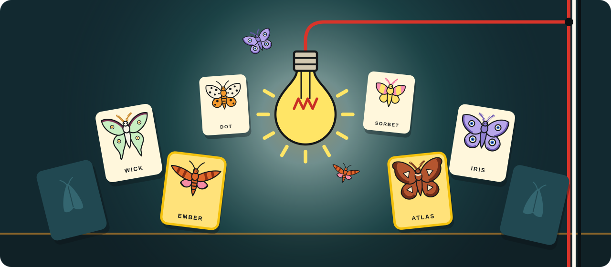
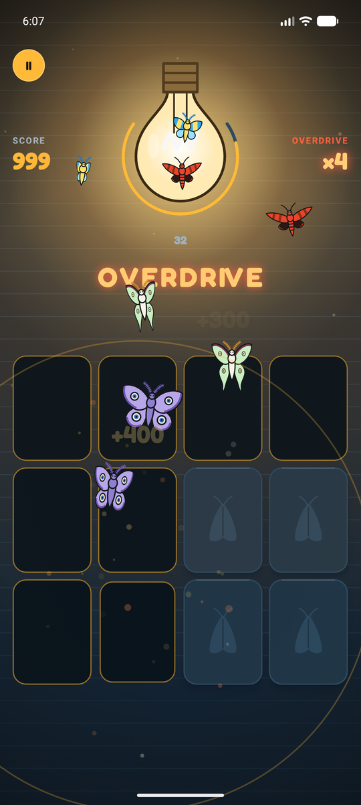
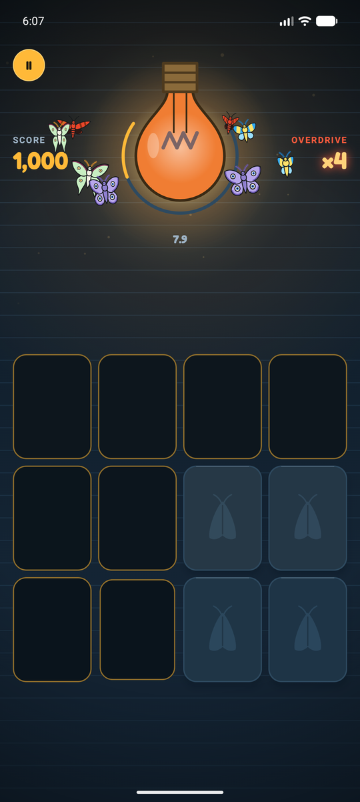
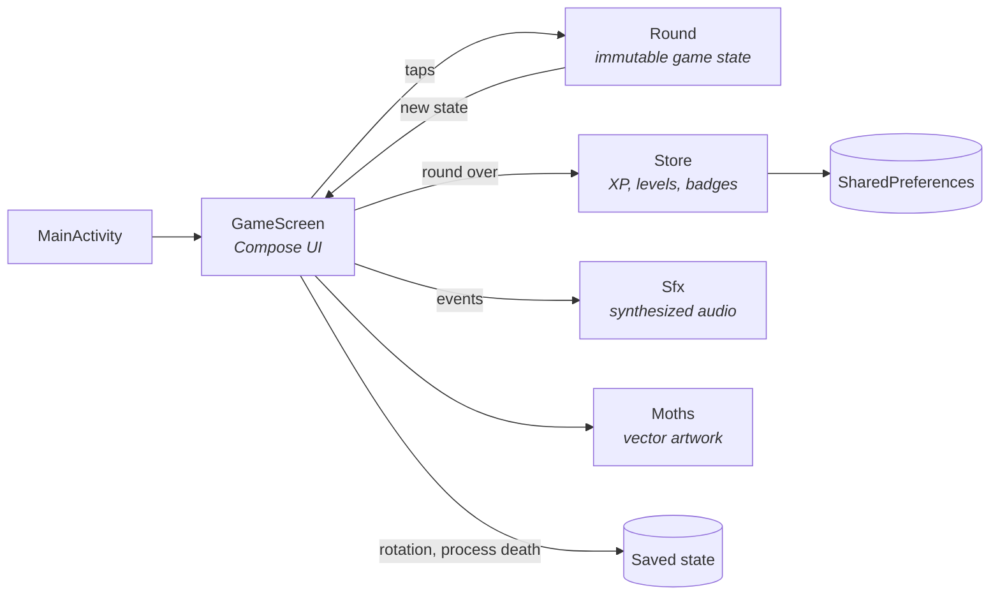

<div align="center">



# Porchlight

**A thirty-second memory game for Android.**<br>
Moths gather at a porch bulb, and the bulb is the clock. Find every pair before it burns out.

<a href="https://github.com/ImtiazHossain-Eshan/porchlight/actions/workflows/android.yml"></a>


<a href="LICENSE"></a>

[Game](#the-game) · [Screens](#screens) · [The moths](#the-moths) · [Nights](#nights-and-the-daily-porch) · [Progression](#progression) · [Architecture](#architecture) · [Get started](#get-started) · [Tests](#tests) · [Releases](#builds-and-releases)

<sub>Designed and built by Imtiaz Hossain</sub>

</div>

---

## The game

You get a two-second look at the cards. Then they fold shut, and the porch bulb starts to burn down.

1. **Peek.** Every card opens for two seconds. Remember where the moths landed.
2. **Match.** Turn two cards. A pair leaves the board: both moths fly up and circle the bulb.
3. **Chain.** Pairs in a row multiply: ×2, ×3, then ×4 *Overdrive*. One wrong pair breaks the chain.
4. **Beat the bulb.** Finish early and every second left is worth 20 more points.

There is no timer bar. **The bulb is the timer.** It burns warm white with time to spare, turns amber as it runs down, and goes deep orange near the end. In the last five seconds it flickers and buzzes. At zero it pops, the moths scatter, and the porch goes dark. A thin arc around the bulb and a small number under it are there if you want the exact time.

Pick a lead moth before each round. Each one bends the rules its own way.

## Screens

<table>
  <tr>
    <td align="center" width="20%"></td>
    <td align="center" width="20%"></td>
    <td align="center" width="20%"></td>
    <td align="center" width="20%"></td>
    <td align="center" width="20%"></td>
  </tr>
  <tr>
    <td align="center"><sub><b>The porch</b><br>Pick a lead and a night</sub></td>
    <td align="center"><sub><b>The peek</b><br>Two seconds to remember</sub></td>
    <td align="center"><sub><b>Overdrive</b><br>Found moths circle the light</sub></td>
    <td align="center"><sub><b>Last seconds</b><br>The bulb runs hot</sub></td>
    <td align="center"><sub><b>Results</b><br>Stars, XP, unlocks</sub></td>
  </tr>
</table>

A 15-second gameplay clip is in [`docs/store/gameplay.mp4`](docs/store/gameplay.mp4).

## The moths

### Six leads

You start with Wick. Each level up brings the next lead to the porch.

| | Moth | Role | Perk | Unlocks |
| :---: | --- | --- | --- | :---: |
|  | **Wick** | The night owl | **Long-life bulb.** The round starts with 5 extra seconds. | Level 1 |
|  | **Ember** | The sprinter | **Hot streak.** Streaks start at ×2, but the bulb is 3 seconds shorter. | Level 2 |
|  | **Atlas** | The mapmaker | **Second look.** Once a round, flash every card open for a moment. | Level 3 |
|  | **Dot** | The counter | **Quick hands.** Tap straight past a wrong pair, and your first miss keeps the streak. | Level 4 |
|  | **Iris** | The watcher | **Long look.** The opening peek lasts 3.4 seconds instead of 2. | Level 5 |
|  | **Sorbet** | The sweet tooth | **Top-up.** Every pair you find adds a second to the bulb. | Level 6 |

A unit test plays every lead with a perfect player and with one who misses 30% of the time, and checks that no lead beats the rest by more than 15% on both score and time.

### Four more on later nights

| | | | |
| :---: | :---: | :---: | :---: |
| <br>**Sulphur** | <br>**Rose** | <br>**Midnight** | <br>**Moss** |

Every moth has one main colour no other moth uses, and a wing shape or pattern of its own, so you can tell any two apart at a glance.

## Nights and the daily porch

Beat a night with two stars or more to open the next. Each night gives about five seconds a pair.

| Night | Board | Bulb | Twist |
| :---: | --- | :---: | --- |
| 1 | 6 pairs, 3 × 4 | 30 s | None |
| 2 | 8 pairs, 4 × 4 | 40 s | Sulphur and Rose join |
| 3 | 10 pairs, 4 × 5 | 50 s | Midnight and Moss join |
| 4 | 10 pairs | 50 s | **Wanderer:** after a wrong pair, two face-down cards swap places |
| 5 | 9 pairs and 2 leaves | 46 s | **Dead leaves:** turning one costs 2 seconds |
| 6 | 10 pairs | 50 s | **Shadow:** one moth is only a silhouette during the peek |

Each new night and twist is introduced once, in one line with a small animation, the first time you play it.

**Daily porch.** The deal comes from today's date, so everyone gets the same porch. You get one scored try a day. Play on consecutive days to build a streak, and share your result:

```
Porchlight daily 20261114 ★★☆ 2,340
```

## Progression

<table>
<tr>
<td valign="top" width="50%">

**XP and levels**

| Source | XP |
| --- | ---: |
| Score | score ÷ 10 |
| Win (or finish) | 50 (10) |
| Each star | 20 |

Levels need 200, 500, 900, 1,400 and 2,000 XP in total.

**Stars**

| Star | For |
| :---: | --- |
| ★ | Finding every pair |
| ★ | A third of the bulb or more left |
| ★ | Not a single wrong pair |

**Mastery.** Win three stars with a lead and that moth turns gold on every card.

</td>
<td valign="top" width="50%">

**Badges**

| Badge | How to earn it |
| --- | --- |
| First light | Finish a round. |
| Clean sweep | Win without a single wrong pair. |
| Quick wings | Win with 15 seconds or more left. |
| Overdrive | Reach a ×4 streak. |
| Melody | Find six pairs in a row. |
| Photo finish | Win with under 2 seconds left. |
| Night shift | Play 10 rounds. |
| Full roster | Win once with every lead. |
| Second night | Beat night 2. |
| Wanderers | Beat night 4. |
| Last light | Beat night 6. |
| Regular | Play the daily porch three days running. |
| Golden wing | Master a moth. |
| Gilded porch | Master all six leads. |

</td>
</tr>
</table>

### Feel

- Every tap answers at once: the card dips under your finger, turns in 3D, lifts off the board, and the moth wakes up and flaps.
- A wrong pair flashes red, shakes, and both moths snap their wings shut.
- Streaks build. ×1 throws a few sparks. ×2 throws more. ×3 adds a bass note, a bulb flare and a warm glow at the screen edge. ×4 *Overdrive* freezes the frame for an instant, shakes the porch, sends a gold shockwave out from the pair and slides OVERDRIVE across.
- When a streak breaks, the counter cracks and drops back to ×1 with a low thunk.
- The score counts up instead of jumping.
- All particles come from one pool of 200 that is allocated once.
- **Reduce motion**, from the settings or the system's animation setting, turns off the shake, freeze and sparks but keeps the colour changes.

### Sound

Every sound is synthesized in the app. The APK ships no audio files. A small mixer plays everything through one stream, so overlapping sounds never cut each other off.

| Moment | Sound |
| --- | --- |
| On the porch and in play | Crickets and a soft bulb hum (Night sounds) |
| Card turns | A soft paper flip, its pitch varied slightly each time |
| Pair found | A chime that climbs C major pentatonic with your streak, so a perfect round plays a tune |
| ×3 and up | A bass note under the chime |
| Wrong pair / streak breaks | A low buzz / a dull thunk |
| Last 5 seconds | A wooden tick each second, and an electric buzz with every flicker |
| Bulb pops | A pop and tinkling glass |
| Win / burn out | A rising sting / the same notes falling |

Sound effects, night sounds, vibration and reduce motion each have their own switch in the settings.

## Architecture

A single-activity Compose app with three screens (Porch, Round, Results) and no navigation library. The game rules are plain Kotlin with no Android dependencies, which is what makes them testable.



| File | What it holds |
| --- | --- |
| [`Game.kt`](app/src/main/java/app/porchlight/game/Game.kt) | Round rules: nights, twists, dealing, peek, matching, streaks, timer, pause, scoring, and saving a round. Every move returns a new immutable `Round`. |
| [`Progress.kt`](app/src/main/java/app/porchlight/game/Progress.kt) | XP, levels, unlocks, stars, mastery, badges, the daily streak, and saving progress. |
| [`GameScreen.kt`](app/src/main/java/app/porchlight/game/GameScreen.kt) | The session: which screen is up, the player's taps, feedback, pausing and saved state. |
| [`Porch.kt`](app/src/main/java/app/porchlight/game/Porch.kt), [`RoundScreen.kt`](app/src/main/java/app/porchlight/game/RoundScreen.kt), [`Results.kt`](app/src/main/java/app/porchlight/game/Results.kt) | The three screens. |
| [`Bulb.kt`](app/src/main/java/app/porchlight/game/Bulb.kt), [`Flock.kt`](app/src/main/java/app/porchlight/game/Flock.kt), [`Scene.kt`](app/src/main/java/app/porchlight/game/Scene.kt) | The bulb that is the timer, the moths that orbit it, and the night wall it lights. |
| [`Cards.kt`](app/src/main/java/app/porchlight/game/Cards.kt), [`Particles.kt`](app/src/main/java/app/porchlight/game/Particles.kt), [`Hud.kt`](app/src/main/java/app/porchlight/game/Hud.kt) | The board, sparks and shockwaves, score pops, and the small pieces of UI. |
| [`Onboarding.kt`](app/src/main/java/app/porchlight/game/Onboarding.kt) | The first-launch tutorial and the one-time night introductions. |
| [`Moths.kt`](app/src/main/java/app/porchlight/game/Moths.kt) | Ten moths and a dead leaf, drawn as vector paths on a Compose `Canvas`. |
| [`Sfx.kt`](app/src/main/java/app/porchlight/game/Sfx.kt) | The synthesizer and the mixer. |
| [`Theme.kt`](app/src/main/java/app/porchlight/game/Theme.kt) | The night palette and the type. |

**Stack:** Kotlin · Jetpack Compose (Material 3) · Android Gradle Plugin 9 · Gradle 9.6 · JUnit 4. Minimum Android 7.0 (API 24). No network, no analytics, no permissions. Progress stays on the device.

**On Android:**
- A round pauses when the app goes to the background, and continues when you tap.
- A round in play survives rotation and the system killing the app.
- The launcher icon is adaptive, with a themed (monochrome) layer for Android 13.
- The app opens on a night-porch splash screen.
- The game draws edge to edge.
- Phones and tablets work in both orientations; on wide screens the board sits beside the bulb.
- A baseline profile compiles the game ahead of time.

**Type:** [Fredoka](https://github.com/hafontia/Fredoka-One) for numbers and titles, under the SIL Open Font License ([`licenses/Fredoka-OFL.txt`](licenses/Fredoka-OFL.txt)).

## Get started

### Install the APK

- **Latest build:** open the [Actions tab](https://github.com/ImtiazHossain-Eshan/porchlight/actions/workflows/android.yml), choose the newest green run, and download **porchlight-debug-apk** under *Artifacts*.
- **Releases:** tagged versions are on the [Releases page](https://github.com/ImtiazHossain-Eshan/porchlight/releases).

Copy the APK to your phone and open it. Android will ask you to allow installing from that source once.

### Build it yourself

You need the Android SDK, which Android Studio installs, and Java 17 to 25. Android Studio's bundled Java works.

```bash
git clone https://github.com/ImtiazHossain-Eshan/porchlight.git
cd porchlight
./gradlew assembleDebug      # APK in app/build/outputs/apk/debug/
./gradlew installDebug       # install on a connected phone or emulator
```

Or open the folder in Android Studio and press **Run**.

If Gradle can't find the SDK, create `local.properties`:

```properties
sdk.dir=C\:/Users/<you>/AppData/Local/Android/Sdk
```

## Tests

81 unit tests cover the rules, the progression system and the balance between leads. They run on the JVM in a few seconds, with no emulator.

```bash
./gradlew testDebugUnitTest
```

| Suite | Covers |
| --- | --- |
| [`GameTest`](app/src/test/java/app/porchlight/game/GameTest.kt) | Dealing and seeded deals, nights, every lead's perk, peek and clock, matching, streaks, misses, time bonus, burn-out, Second look, the three twists, pause and resume, saving and restoring a round, the tutorial |
| [`ProgressTest`](app/src/test/java/app/porchlight/game/ProgressTest.kt) | XP curve, levels, unlocks, stars, opening nights, mastery, the daily porch and its streak, the share line, badges |
| [`BalanceTest`](app/src/test/java/app/porchlight/game/BalanceTest.kt) | Simulated perfect and typical players with every lead: none may beat the rest by more than 15% on both score and time |

CI runs them on every push. A failing test stops the build and uploads the HTML report.

## Builds and releases

[`.github/workflows/android.yml`](.github/workflows/android.yml) runs on every push to `main`, every pull request, and on demand:

1. Runs the unit tests.
2. Builds a debug APK and uploads it as an artifact.
3. On a `v*` tag, publishes a GitHub Release with the APK attached. The tag becomes the version name and the run number the version code.

```bash
git tag v0.2.0
git push origin v0.2.0
```

<details>
<summary><b>Signed release APKs (optional)</b></summary>

<br>

Without signing secrets, a release carries the debug APK. That's fine for testing, but it can't go on the Play Store, and an update built on another machine won't install over it.

**Quick way:** run the setup script once. It creates the key outside the repo and uploads the four secrets with the GitHub CLI:

```powershell
powershell -ExecutionPolicy Bypass -File scripts\setup-signing.ps1
```

**By hand:**

1. Create a keystore once and back it up. Losing it means you can't ship updates under the same key.

   ```bash
   keytool -genkeypair -v -keystore porchlight-release.jks -alias porchlight -keyalg RSA -keysize 4096 -validity 10000
   ```

2. Encode it. In Windows PowerShell:

   ```powershell
   [Convert]::ToBase64String([IO.File]::ReadAllBytes("porchlight-release.jks")) | Set-Clipboard
   ```

3. In **Settings → Secrets and variables → Actions**, add:

   | Secret | Value |
   | --- | --- |
   | `PORCHLIGHT_KEYSTORE_BASE64` | the base64 text |
   | `PORCHLIGHT_KEYSTORE_PASSWORD` | the keystore password |
   | `PORCHLIGHT_KEY_ALIAS` | `porchlight` |
   | `PORCHLIGHT_KEY_PASSWORD` | the key password |

Tagged releases are then signed with your key. `.gitignore` keeps `*.jks` files out of the repo.

</details>

## Store listing

[`docs/store/`](docs/store/) holds what a Play Store listing needs:
- the store description, which leads with the bulb-as-timer hook
- a 1024 × 500 feature graphic
- five full-size phone screenshots
- the 15-second gameplay clip

## License

[MIT](LICENSE) © 2026 Imtiaz Hossain. The moths, artwork and sounds are original to this project. Fredoka is © The Fredoka Project Authors, under the SIL Open Font License.

<div align="center">
<br>

<br>
<sub>Leave the light on.</sub>
</div>
