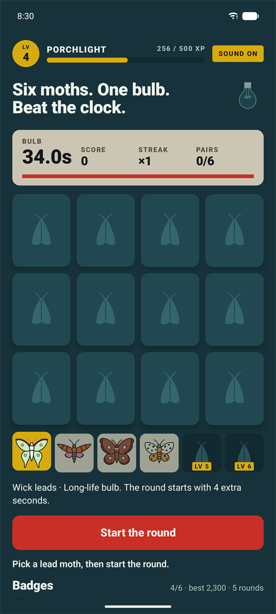
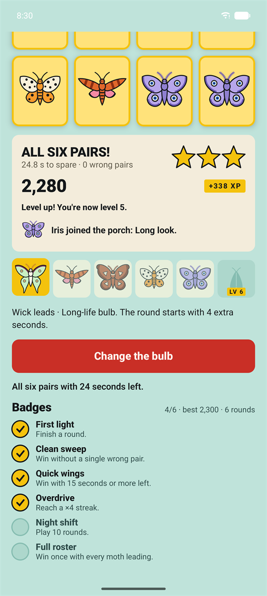
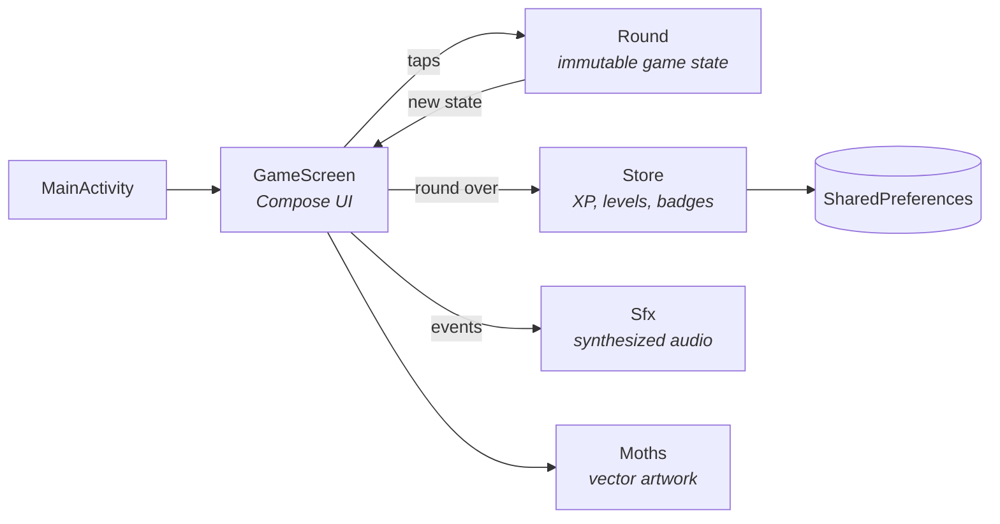

<div align="center">


# Porchlight

**A thirty-second memory game for Android.**<br>
Six moths gather at a porch bulb. The bulb is the clock: find every pair before it burns out.

<a href="https://github.com/ImtiazHossain-Eshan/porchlight/actions/workflows/android.yml"></a>


<a href="LICENSE"></a>

[Game](#the-game) · [Screens](#screens) · [The moths](#the-six-moths) · [Progression](#progression) · [Architecture](#architecture) · [Get started](#get-started) · [Tests](#tests) · [Releases](#builds-and-releases)

<sub>Designed and built by Imtiaz Hossain</sub>

</div>

---

## The game

You get a two-second look at twelve cards. Then they fold shut and the porch bulb starts burning down.

1. **Peek.** Every card opens for two seconds. Remember where the moths landed.
2. **Match.** Turn two cards. A pair stays open and scores 100.
3. **Chain.** Pairs in a row multiply: ×2, ×3, then ×4 *Overdrive*. One wrong pair resets the chain.
4. **Beat the bulb.** Finish early and every second left is worth 20 more points.

Pick a lead moth before each round. Each one bends exactly one rule.

## Screens

<table>
  <tr>
    <td align="center" width="20%"></td>
    <td align="center" width="20%"></td>
    <td align="center" width="20%"></td>
    <td align="center" width="20%"></td>
    <td align="center" width="20%"></td>
  </tr>
  <tr>
    <td align="center"><sub><b>Lights off</b><br>Pick a lead, start the round</sub></td>
    <td align="center"><sub><b>The peek</b><br>Two seconds to remember</sub></td>
    <td align="center"><sub><b>Overdrive</b><br>Chains multiply to ×4</sub></td>
    <td align="center"><sub><b>Results</b><br>Stars, XP, unlocks</sub></td>
    <td align="center"><sub><b>Badges</b><br>Six to collect</sub></td>
  </tr>
</table>

## The six moths

You start with Wick. Each level up brings the next moth to the porch.

| | Moth | Role | Perk | Unlocks |
| :---: | --- | --- | --- | :---: |
|  | **Wick** | The night owl | **Long-life bulb.** The round starts with 4 extra seconds. | Level 1 |
|  | **Ember** | The sprinter | **Hot streak.** Your streak multiplier starts at ×2. | Level 2 |
|  | **Atlas** | The mapmaker | **Second look.** Once a round, flash every card open for a moment. | Level 3 |
|  | **Dot** | The counter | **Quick hands.** A wrong pair folds back in half the time. | Level 4 |
|  | **Iris** | The watcher | **Long look.** The opening peek lasts 3.4 seconds instead of 2. | Level 5 |
|  | **Sorbet** | The sweet tooth | **Top-up.** Every pair you find adds 1.5 seconds to the bulb. | Level 6 |

## Progression

<table>
<tr>
<td valign="top" width="50%">

**XP and levels**

Every round earns XP:

| Source | XP |
| --- | ---: |
| Score | score ÷ 10 |
| Win (or finish) | 50 (10) |
| Each star | 20 |

Levels need 200, 500, 900, 1,400 and 2,000 XP in total. A clean win is usually worth about 300.

**Stars**

| Star | For |
| :---: | --- |
| ★ | Finding all six pairs |
| ★ | Finishing with 10 seconds or more left |
| ★ | Not a single wrong pair |

</td>
<td valign="top" width="50%">

**Badges**

| Badge | How to earn it |
| --- | --- |
| First light | Finish a round. |
| Clean sweep | Win without a single wrong pair. |
| Quick wings | Win with 15 seconds or more left. |
| Overdrive | Reach a ×4 streak. |
| Night shift | Play 10 rounds. |
| Full roster | Win once with every moth leading. |

**Feel**

- A score burst floats off every pair, with the streak called out.
- Cards turn in 3D, unfold their wings, bounce on a match and shake on a miss.
- The whole porch lights up when a round starts and drops dark when the bulb dies.
- Matches and misses buzz the phone.

</td>
</tr>
</table>

### Sound

Every sound is synthesized in the app from sine, square, triangle and noise voices. The APK ships no audio files.

| Moment | Sound |
| --- | --- |
| Round starts | A switch click and a mains hum |
| Peek ends | A rising tone |
| Card turns | A soft tick |
| Pair found | A chime that climbs in pitch with your streak |
| Wrong pair | A low buzz |
| Last 5 seconds | A tick each second |
| Win / burn out | A rising jingle / a falling tone |
| Level up or badge | A short fanfare |

Sound can be switched off from the top bar; the setting is remembered.

## Architecture

A single-activity Compose app. The game rules are plain Kotlin with no Android dependencies, which is what makes them testable.



| File | What it holds |
| --- | --- |
| [`Game.kt`](app/src/main/java/app/porchlight/game/Game.kt) | Round rules: dealing, peek, matching, streaks, timer, scoring. Every move returns a new immutable `Round`. |
| [`Progress.kt`](app/src/main/java/app/porchlight/game/Progress.kt) | XP curve, levels, moth unlocks, stars, badges, and saving progress. |
| [`Sfx.kt`](app/src/main/java/app/porchlight/game/Sfx.kt) | A tiny synthesizer that renders every sound effect at start-up. |
| [`Moths.kt`](app/src/main/java/app/porchlight/game/Moths.kt) | The six moths, card backs and bulb, drawn as vector paths on a Compose `Canvas`. |
| [`GameScreen.kt`](app/src/main/java/app/porchlight/game/GameScreen.kt) | The game screen, its two palettes (porch light off and on), and all animation. |
| [`MainActivity.kt`](app/src/main/java/app/porchlight/game/MainActivity.kt) | Entry point. |

**Stack:** Kotlin · Jetpack Compose (Material 3) · Android Gradle Plugin 9 · Gradle 9.6 · JUnit 4. Minimum Android 7.0 (API 24). No network, no analytics, no permissions. Progress stays on the device.

## Get started

### Install the APK

- **Latest build:** open the [Actions tab](https://github.com/ImtiazHossain-Eshan/porchlight/actions/workflows/android.yml), choose the newest green run, and download **porchlight-debug-apk** under *Artifacts*.
- **Releases:** tagged versions are on the [Releases page](https://github.com/ImtiazHossain-Eshan/porchlight/releases).

Copy the APK to your phone and open it. Android will ask you to allow installing from that source once.

### Build it yourself

You need the Android SDK, which Android Studio installs, and Java 17 to 25. Android Studio's bundled Java works.

```bash
git clone https://github.com/ImtiazHossain-Eshan/porchlight.git
cd porchlight
./gradlew assembleDebug      # APK in app/build/outputs/apk/debug/
./gradlew installDebug       # install on a connected phone or emulator
```

Or open the folder in Android Studio and press **Run**.

If Gradle can't find the SDK, create `local.properties`:

```properties
sdk.dir=C\:/Users/<you>/AppData/Local/Android/Sdk
```

## Tests

47 unit tests cover the rules and the progression system. They run on the JVM in a few seconds, with no emulator.

```bash
./gradlew testDebugUnitTest
```

| Suite | Covers |
| --- | --- |
| [`GameTest`](app/src/test/java/app/porchlight/game/GameTest.kt) | Dealing, every lead's perk, peek and clock, matching, streak multipliers and the ×4 cap, misses, time bonus, burn-out, Second look |
| [`ProgressTest`](app/src/test/java/app/porchlight/game/ProgressTest.kt) | XP curve, level boundaries, unlock order, star rules |

CI runs them on every push. A failing test stops the build and uploads the HTML report.

## Builds and releases

[`.github/workflows/android.yml`](.github/workflows/android.yml) runs on every push to `main`, every pull request, and on demand:

1. Runs the unit tests.
2. Builds a debug APK and uploads it as an artifact.
3. On a `v*` tag, publishes a GitHub Release with the APK attached. The tag becomes the version name and the run number the version code.

```bash
git tag v0.2.0
git push origin v0.2.0
```

<details>
<summary><b>Signed release APKs (optional)</b></summary>

<br>

Without signing secrets, a release carries the debug APK. That's fine for testing, but it can't go on the Play Store, and an update built on another machine won't install over it.

1. Create a keystore once and back it up. Losing it means you can't ship updates under the same key.

   ```bash
   keytool -genkeypair -v -keystore porchlight-release.jks -alias porchlight -keyalg RSA -keysize 4096 -validity 10000
   ```

2. Encode it. In Windows PowerShell:

   ```powershell
   [Convert]::ToBase64String([IO.File]::ReadAllBytes("porchlight-release.jks")) | Set-Clipboard
   ```

3. In **Settings → Secrets and variables → Actions**, add:

   | Secret | Value |
   | --- | --- |
   | `PORCHLIGHT_KEYSTORE_BASE64` | the base64 text |
   | `PORCHLIGHT_KEYSTORE_PASSWORD` | the keystore password |
   | `PORCHLIGHT_KEY_ALIAS` | `porchlight` |
   | `PORCHLIGHT_KEY_PASSWORD` | the key password |

Tagged releases are then signed with your key. `.gitignore` keeps `*.jks` files out of the repo.

</details>

## License

[MIT](LICENSE) © 2026 Imtiaz Hossain. The moths, artwork and sounds are original to this project.

<div align="center">
<br>

<br>
<sub>Leave the light on.</sub>
</div>
