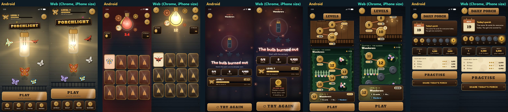
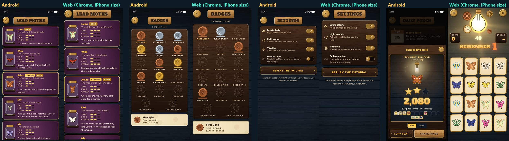

# Porchlight on Android, iPhone and the web

One game, three hosts. The rules and every screen are shared (`shared/`, Kotlin Multiplatform and
Compose Multiplatform); each platform supplies storage, sound, tilt, haptics and sharing through one
`Platform` object.

**works**: the same as Android. **fallback**: works, in a plainer or different way. **missing**:
not there. **(nv)**: built and compiled, but not verified on a real device. Nothing on iOS has
run yet (no Mac; the CI workflow has not run), so every iOS cell carries (nv).

## Feature parity

| Feature | Android | iOS | Web |
|---|---|---|---|
| **Play** | | | |
| 50 levels, 5 chapters, star gates, twists | works | works (nv) | works |
| Six lead moths and their perks | works | works (nv) | works |
| Daily porch (same deal for everyone, by local date) | works | works (nv) | works |
| Tutorial and twist introductions | works | works (nv) | works |
| XP, badges, mastery, the Easier bulb | works | works (nv) | works |
| Cards turn on touch down | works | works (nv) | works |
| **Save** | | | |
| Progress and settings saved | works (SharedPreferences) | works (nv) (NSUserDefaults, same keys) | works (localStorage, same keys) |
| Old six-night saves carried over | works | n/a (no old saves) | n/a (no old saves) |
| A live round survives the system closing the app | works (saved state) | fallback (nv): the round is lost if iOS ends the app; progress is kept | fallback: a reload loses the round; progress is kept |
| **Sound and feel** | | | |
| Synthesized sound effects | works (AudioTrack) | works (nv) (AVAudioEngine, ambient) | works (Web Audio, after the first tap) |
| Night ambience loop | works | works (nv) | works |
| Sound off / music off settings | works | works (nv) | works |
| Haptics | works | works (nv) (UIKit feedback generators) | missing (no vibration API in iPhone Safari) |
| Tilt parallax | works (rotation vector) | works (nv) (CoreMotion, 60 Hz) | works (DeviceOrientation; iPhone asks permission on a tap) (nv on iPhone) |
| **Look** | | | |
| Fonts (Alfa Slab One, Fredoka with its weights) | works | works (nv) (Skia, as the web) | works |
| Card foil, bulb glow, heat shimmer, Overdrive split (shaders) | works (AGSL, Android 13+); fallback below | works (nv) (SkSL, same source) | works (SkSL on WebGL); `?noshaders` shows the fallback |
| Bloom and blur | works (Android 12+); fallback below | works (nv) | works |
| Quality steps down on slow frames | works | works (nv) | works |
| 60/120 Hz | works (the screen's rate) | works (nv) (`CADisableMinimumFrameDurationOnPhone`) | fallback: the browser's rate (60 on iPhone Safari) |
| **Screen** | | | |
| Edge to edge, safe areas | works | works (nv) | works (CSS safe-area insets) |
| Status bar and home indicator hidden in a round, edge swipes deferred | missing (as before: Android shows its bars) | works (nv) | n/a (the browser's own bars) |
| Orientation | works: both, board beside the bulb on wide screens | works (nv): portrait on iPhone, all on iPad | fallback: portrait on phones ("turn your phone upright"), any on tablets and computers |
| Back | works (back key and gesture) | fallback (nv): on-screen back and close buttons on every screen | fallback: on-screen buttons; Esc does nothing |
| Pause when the app goes away | works (background) | works (nv) (inactive: calls, Control Center; and background) | works (hidden tab, page hide) |
| Reduce motion | works (in-game toggle, or animations off) | works (nv) (toggle, or iOS Reduce Motion, followed live) | works (toggle, or `prefers-reduced-motion`) |
| Large text | works (Android font scale) | works (nv) (Dynamic Type, capped at Android's 2×) | fallback: the browser's zoom is locked; text stays at its base size |
| **Share** | | | |
| Daily share card as an image | works (share sheet) | works (nv) (UIActivityViewController; popover on iPad) | works (`navigator.share` with the PNG); fallback: the PNG downloads and the text is copied |
| Share text, copy text | works | works (nv) | works |
| **App** | | | |
| Icon | works (adaptive, themed) | works (nv) (from the same art) | works (PWA icons, apple-touch-icon) |
| Splash / launch screen | works | works (nv) (wall colour, bulb and moth) | fallback: a loading screen with the icon |
| Offline | works | works (nv) | works after the first visit (service worker) |
| Install | APK, GitHub Releases | TestFlight (needs the Apple setup in `IOS_RELEASE.md`) | Add to Home Screen |
| Network, analytics, tracking | none | none (privacy manifest: no tracking, no data) | none |
| Debug launch options | `--ei level`, `--ei setXp`, `--ei quality`, `--ef tiltX/Y`, `--ei pretendApi`, `--es screen` | `--level`, `--setXp`, `--quality`, `--screen` (debug builds) | `?noshaders`, `?noblur` |
| Baseline profile (faster start) | works | n/a | n/a |

## Tests on each platform

| Target | Command | Tests | Where it runs |
|---|---|---|---|
| Android (JVM) | `./gradlew testDebugUnitTest` | 151 (3 tuner tests skipped) | locally and in `android.yml` |
| Web (Wasm, headless Chrome) | `./gradlew :shared:wasmJsBrowserTest` | 138 | locally and in `web.yml` |
| iOS simulator | `./gradlew :shared:iosSimulatorArm64Test` | 138 | `ios.yml` on macOS (not yet run) |

The 13 JVM-only tests are the level tuner, the level curve (simulated players) and the formatter
parity checks against Java's `String.format`.

## Side by side

Android (the emulator, phase 0) beside the web build (headless Chrome at 393 × 852, with a save
seeded to match: level 12, 3,000 XP, today's daily played). The moths, motes and the bulb move, so
no two captures match pixel for pixel; star counts differ where the seeded save does.

iOS screenshots come from the `simulator` job in `ios.yml` (artifact `ios-simulator-screenshots`)
once it runs.

## The phases

The port was done in eight committed phases; each has its own report in
[`docs/multiplatform/`](multiplatform): baseline, shared logic, shared UI, platform services, the web
build, the iOS app, iOS CI, iPhone polish, and this handover.
